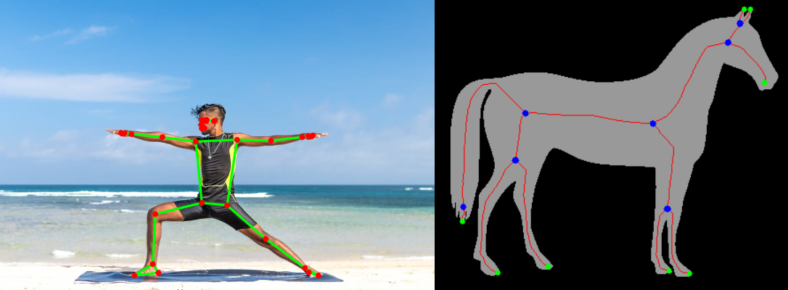

# skelex — 이미지·동영상 스켈레톤 추출

이미지와 동영상에서 두 가지 스켈레톤을 추출합니다.

| 모드 | 하는 일 | 엔진 |
|---|---|---|
| `pose` | 사람의 관절 33개 키포인트(코, 어깨, 팔꿈치, 손목, 골반, 무릎, 발목 …)를 뽑아 스켈레톤으로 연결 | MediaPipe Pose Landmarker |
| `morph` | 이진화한 형태(물체·글자·혈관·균열 등)의 중심선(골격선)을 추출 | scikit-image (skeletonize / medial axis / thin) |



## 설치

```bash
git clone https://github.com/nonmoon0427/skeleton.git
cd skeleton
pip install -e .
```

Python 3.9 이상. `pose` 모드는 처음 실행할 때 모델(약 9MB)을 `~/.cache/skelex/`에 자동으로 받습니다
(`SKELEX_MODEL_DIR` 환경변수로 위치 변경 가능, 오프라인이면 `--model-path`로 직접 지정).

> 리눅스 서버/도커에서 `libEGL.so.1` 오류가 나면: `sudo apt-get install -y libegl1 libgles2`

## 사용법

입력으로 이미지 파일, 동영상 파일, 폴더(하위 폴더까지 검색)를 섞어서 넣을 수 있습니다.

### 사람 포즈 스켈레톤

```bash
skelex pose photo.jpg -o outputs
skelex pose dance.mp4 -o outputs
skelex pose ./my_data -o outputs --model heavy --num-poses 3
skelex pose long_video.mp4 --stride 2 --no-video     # 2프레임마다, 데이터만 저장
```

| 옵션 | 설명 |
|---|---|
| `--model lite/full/heavy` | 빠름 ↔ 정확함 (기본 `full`) |
| `--num-poses N` | 프레임당 최대 인원 수 (기본 1) |
| `--min-confidence` | 검출/추적 신뢰도 기준 (기본 0.5) |
| `--min-visibility` | 이 값보다 안 보이는 관절은 그리지 않음 (기본 0.5) |
| `--stride N` | 동영상에서 N프레임마다 처리 |
| `--no-video` | 동영상 결과 영상은 만들지 않고 JSON/CSV/NPY만 저장 |

출력 (`<이름>` = 입력 파일 이름):

- `<이름>_pose.png` / `.mp4` — 원본 위에 스켈레톤을 그린 결과
- `<이름>_pose_skeleton.png` / `.mp4` — 검은 배경에 스켈레톤만
- `<이름>_pose.json` — 사람별 33개 키포인트 (`x`,`y` 픽셀 좌표, `z` 상대 깊이, `visibility`, `world_x/y/z` 미터 단위 3D 좌표), 관절 이름, 연결 정보
- `<이름>_pose.csv` — 한 행 = 프레임 × 사람 × 관절 (엑셀/pandas용)
- `<이름>_pose.npy` (동영상) — `(프레임, 사람, 33, [x, y, z, visibility])` 배열, 미검출은 NaN. 행동인식 등 학습 데이터로 바로 사용 가능

```python
import numpy as np
seq = np.load("outputs/dance_pose.npy")   # (T, P, 33, 4)
left_wrist = seq[:, 0, 15, :2]            # 0번 사람의 왼쪽 손목 궤적
```

### 형태 골격선 (morphological skeleton)

```bash
skelex morph shape.png -o outputs
skelex morph crack.jpg -o outputs --invert --prune 15      # 어두운 물체 + 짧은 가지 제거
skelex morph vessel.png --method medial                    # 두께 정보까지
skelex morph cells.mp4 -o outputs --stride 5
```

| 옵션 | 설명 |
|---|---|
| `--method` | `zhang`(기본), `lee`, `medial`(중심축 + 두께), `thin` |
| `--threshold 0-255` | 고정 임계값 (기본: Otsu 자동) |
| `--invert` | 물체가 배경보다 어두울 때 |
| `--blur` | 이진화 전 가우시안 블러 커널 (0=끔, 기본 3) |
| `--min-size` | 이보다 작은 잡음 덩어리 제거 (기본 64픽셀) |
| `--prune N` | 길이 N픽셀 이하의 잔가지 제거 |
| `--thickness` | 출력 골격선 굵기 |

출력:

- `<이름>_mask.png` — 이진화 결과 (이미지)
- `<이름>_skeleton.png` / `.mp4` — 골격선
- `<이름>_overlay.png` / `.mp4` — 원본 위 골격선 (초록 = 끝점, 파랑 = 분기점)
- `<이름>_skeleton.json` — 골격 픽셀 수, 연결 요소 수, 끝점·분기점 좌표, (`medial`일 때) 평균/최대 두께

## 파이썬에서 쓰기

```python
from skelex.io import read_image
from skelex.pose import PoseConfig, PoseExtractor
from skelex.morph import MorphConfig, extract

img = read_image("photo.jpg")

with PoseExtractor(PoseConfig(model="lite"), video=False) as ex:
    people = ex.detect(img)          # [[{id, name, x, y, z, visibility, ...} × 33], ...]

mask, skel, dist = extract(img, MorphConfig(method="medial"))   # skel: bool 배열
```

## 관절 번호 (pose)

```
0 nose            11 left_shoulder   12 right_shoulder   23 left_hip    24 right_hip
1-3 left eye      13 left_elbow      14 right_elbow      25 left_knee   26 right_knee
4-6 right eye     15 left_wrist      16 right_wrist      27 left_ankle  28 right_ankle
7 left_ear        17/19/21 left hand (pinky/index/thumb)  29 left_heel   30 right_heel
8 right_ear       18/20/22 right hand                     31 left_foot_index  32 right_foot_index
9-10 mouth
```

## 테스트

```bash
pip install -e ".[dev]"
pytest
```

포즈 테스트는 샘플 이미지와 모델을 내려받기 때문에 오프라인이면 자동으로 건너뜁니다.
